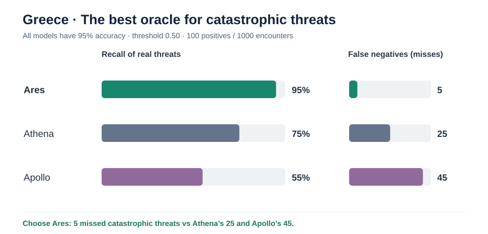

# 🇬🇷 Greece — Doar o chestie între frați / Just a Thing Between Siblings

## Final answer

**Accepted flag reported by the contestant: `SIGMOID_ARES`.**

The question is not which classifier has the highest accuracy (all three have **95%**) but which one **misses the fewest real catastrophic threats**. The positive class is `is_catastrophic_threat == 1`, so **recall / sensitivity and false negatives** determine the choice.



## Results — exact threshold 0.50

All 1,000 examples, with 100 true catastrophic threats and 900 non-catastrophic encounters:

| Model | Accuracy | Precision (positive) | Recall / sensitivity | F1 (positive) | True positives | False negatives | False positives | True negatives |
|---|---:|---:|---:|---:|---:|---:|---:|---:|
| **Ares** | **95%** | 67.86% | **95%** | **79.17%** | **95** | **5** | 45 | 855 |
| Athena | 95% | 75.00% | 75% | 75.00% | 75 | 25 | 25 | 875 |
| Apollo | 95% | 91.67% | 55% | 68.75% | 55 | 45 | 5 | 895 |

These counts come from running the PyTorch models at `sigmoid(logit) >= 0.50`. The confusion matrix treats **catastrophic threat as the positive label**.

### Why accuracy alone is misleading

The models all make **50 mistakes** out of 1,000:
- Ares: 5 false negatives + 45 false positives
- Athena: 25 false negatives + 25 false positives
- Apollo: 45 false negatives + 5 false positives

Accuracy assigns equal cost to false positives and false negatives, but the task states that **missing a real catastrophic threat is substantially more costly than an unnecessary alarm**.

If, purely to illustrate the trade-off, a missed threat costs ten units and an unnecessary alarm costs one unit, then estimated total error costs are:
- **Ares:** `5 × 10 + 45 × 1 = 95`
- Athena: `25 × 10 + 25 × 1 = 275`
- Apollo: `45 × 10 + 5 × 1 = 455`

The example costs are not organizer-provided business numbers; the selection already follows directly from the stated high cost of false negatives. For this task, **Ares wins by a large margin on recall and number of missed threats**.

## How it was evaluated

1. Load [`test_dataset.csv`](test_dataset.csv) and [`test_labels.csv`](test_labels.csv); join labels to features by the **`encounter_id`** key.
2. Use the **exact nine numeric features and their order** from the organizer's [`model.py`](model.py). Other columns such as `region` and `moon_phase` are metadata, not model inputs.
3. Instantiate `MythicThreatClassifier`, load the state dictionaries from `models/model_{name}.pth` with PyTorch, set `eval()` and run inference without gradients.
4. Convert the raw logits to probabilities using `torch.sigmoid()` and threshold each at **0.50**.
5. Calculate accuracy, precision, recall, F1, specificity, balanced accuracy, and the four confusion-matrix cells for all three models.

The supplied checkpoint weights were **reserialized in a compact, older PyTorch-compatible format** when committed, preserving their numerical parameter tensors exactly; the GitHub files are functionally equivalent but not byte-for-byte copies of the originally provided archives.

As a cross-check, the supplied linear models assign weight 1 to different features and zero to all other features, with zero bias: Ares uses `oracle_omen`, Athena uses `aegis_resonance`, and Apollo uses `styx_disturbance`. Inference in [`evaluate.py`](evaluate.py) **still loads the actual committed PyTorch checkpoints**, rather than substituting a hand-written rule.

## Run it yourself

```bash
python -m pip install -r requirements.txt
python evaluate.py
```

The script checks that the 1,000 encounter IDs match, checks the label count and original accuracies, and writes:
- [`metrics.csv`](metrics.csv): the comparison table including all confusion matrix counts
- [`predictions.csv`](predictions.csv): each example's true label, probability, and thresholded prediction for every model

[Open the visual comparison](comparison.svg).

## Source files

- [Organizer architecture](model.py)
- [Organizer-provided test features](test_dataset.csv)
- [Organizer-provided test labels](test_labels.csv)
- [Model Ares checkpoint](models/model_ares.pth)
- [Model Athena checkpoint](models/model_athena.pth)
- [Model Apollo checkpoint](models/model_apollo.pth)
- [Pinned dependency versions](requirements.txt)

Official challenge dataset: https://drive.google.com/drive/folders/1wg1-xfTWUagA78WRMw3PU9PN4BU1mqns?usp=sharing

**Conclusion:** `SIGMOID_ARES` — the model with the fewest catastrophic threats missed.
