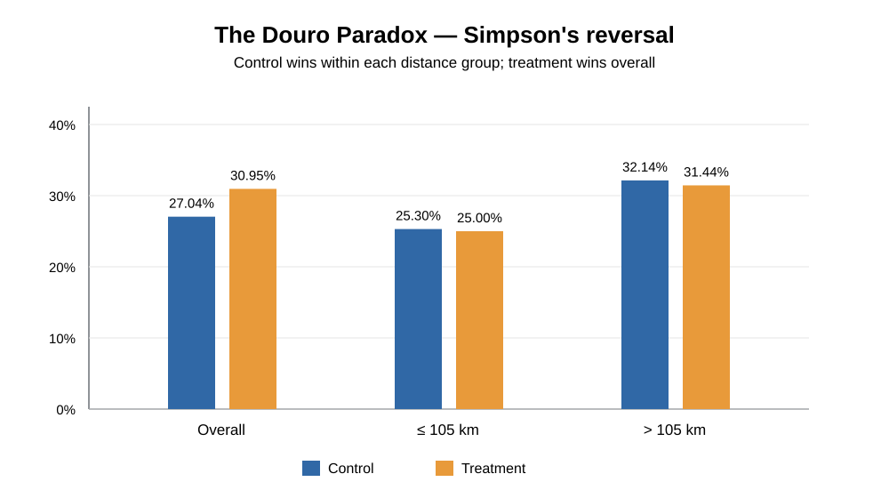

# Portugal — The Douro Paradox (SIGMOID)

## Flag

**`SIGMOID_DISTANCE_FROM_PORTO_KM`**

## The Simpson's paradox reversal

The original dataset contains **3,543 vineyard plots**. Pooled together, the new irrigation treatment appears better. Splitting plots by **`distance_from_porto_km`** at **105 km** reverses the result in **both** groups.

| Group | Control success | Treatment success | Control wins? |
|---|---:|---:|---|
| **All plots** | 447 / 1,653 = **27.04%** | 585 / 1,890 = **30.95%** | No |
| **Distance ≤ 105 km** | 312 / 1,233 = **25.30%** | 36 / 144 = **25.00%** | **Yes** |
| **Distance > 105 km** | 135 / 420 = **32.14%** | 549 / 1,746 = **31.44%** | **Yes** |

The treatment group includes a much larger share of plots in the higher-success distant group (1,746/1,890), whereas most controls are in the lower-success near group (1,233/1,653). Pooling over these **unequally represented distance groups** creates the misleading treatment advantage.

## Supporting figure

The figure compares the exact success rates shown above.

## Reproduce

1. Download `douro_vineyard_data.csv` from the [original challenge data folder](https://drive.google.com/drive/folders/1NEtS0uwNpa_1iI0nZkXToIvLrk7CaKoD?usp=sharing).
2. Place the CSV next to [`solve.py`](solve.py).
3. Install `pandas` and `matplotlib`.
4. Run `python solve.py`. The script prints all success counts/rates, **asserts** the pooled and within-group inequalities and saves `simpsons_paradox.png` and `simpsons_paradox.svg`.

The displayed numbers were verified against the uploaded 3,543-row dataset.
