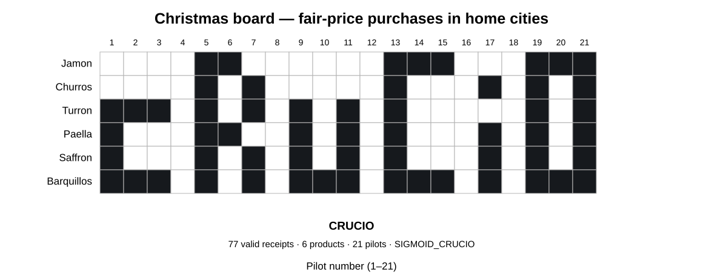

# Spain — ¡Feliz Navidad! (SIGMOID)

**Recovered flag: `SIGMOID_CRUCIO`**.

## Challenge and method

Reconstruct the Christmas purchase board using 21 pilot columns and six souvenir rows in the office's original order. Each black cell means that the given pilot has **at least one receipt** for that souvenir where:

1. The city matches the souvenir's `Home_city`.
2. `Total_paid_eur / Quantity` falls within the guide's **inclusive** `Fair_min_eur`–`Fair_max_eur` range.

All other receipt fields are irrelevant to the office rule. Duplicate qualifying receipts for the same pilot/item count as just one board cell.

## Evidence

- Source: 577 receipt rows and 6 guide rows.
- **77** receipt rows satisfy the full rule.
- The 6 × 21 binary grid spells **CRUCIO** when read left-to-right (some glyphs are lowercase-shaped).
- [View the resulting board figure](christmas_board.svg). This SVG was derived from the validated binary grid; the script also creates `christmas_board.png`.

## Reproduce

Use Python with `pandas==2.3.3`, `numpy==2.2.6`, and `matplotlib==3.10.9`. Download the two CSV inputs from the [official SIGMOID folder](https://drive.google.com/drive/folders/1w4N7Y662Ak5SYM2uF-K5vzJ28y41BlIQ?usp=sharing) into this directory:

- `purchases.csv`
- `office_price_guide.csv`

Then run `python solution.py`. The program generates the PNG and prints the exact six board rows. Compare them visually with the figure above. The flag is **read from the resulting figure**; the script does not need a hardcoded answer.

## Files

- [`solution.py`](solution.py): data joining, fair-price filtering, presence matrix, and plotting
- [`christmas_board.svg`](christmas_board.svg): visible, reviewable evidence figure
- [Official data](https://drive.google.com/drive/folders/1w4N7Y662Ak5SYM2uF-K5vzJ28y41BlIQ?usp=sharing): original inputs
